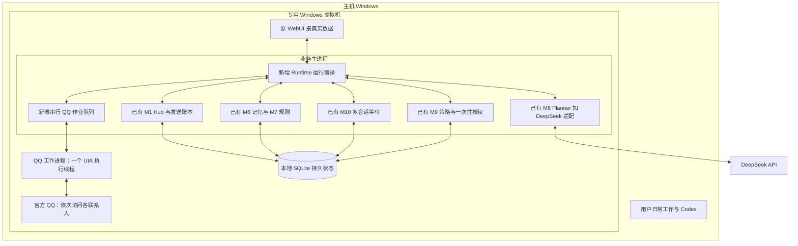

# Personal Messenger AI V5：QQ 多联系人运行总架构

日期：2026-09-09。状态：架构设计，尚未实施。本文是当前实施依据，覆盖早期“先交付单联系人产品”的范围安排。

## 0. 本次交付目标

**直接实现多个联系人可运行的 QQ 自动回复系统。** 保留原项目已经实现的多联系人核心，以开源 QQ UI 操作代码补齐真实执行层，在 Windows 虚拟机中运行，使用 DeepSeek API 生成回复。

最终验收必须至少覆盖 3 个不同好友，并进行 5 个配置联系人的调度检查。联系人数量可配置，不在代码中写死为 3 或 5；这些是首轮验证规模，不代表无限容量承诺。单个控件、单个会话测试只作为模块测试，不能当作最终交付。

产品范围：一个个人 QQ 账号、多个用户指定好友、文字聊天、分联系人上下文/记忆/规则、0～3 条回复、等待取消、人工接管、发送核实、可见状态和重启恢复。未绑定的人不自动回复。群聊、微信、图片/语音/文件以及多个 QQ 账号不作为本版完成条件。

用户继续在主机使用 Codex 和日常软件。自动化允许占用虚拟机内部桌面，不得借助宿主键鼠操作虚拟机窗口。DeepSeek 是回复生成服务，Codex 不进入每条消息的运行链。

工程定位：**延续原项目的中小型集成改造**。新增工作集中在客体执行层、多会话观察、跨模块编排及真实验收，不重写已有记忆、规则和调度系统。

## 1. 已核实的原项目，而不是按交接材料推测

本次阅读的原项目根目录为：

`C:\Users\xiayu\Documents\Codex\2026-09-07\qq-codex-chatgpt-conversation-6a9b9c7e-9364\outputs\personal-messenger-ai`

下表中的 `domain/`、`hub/`、`memory/` 等源码路径以该项目的 `src/messenger_ai/` 为基准；`scripts/`、`tests/`、`rulepacks/` 以项目根目录为基准。这里“已有”表示源码存在且相关实现已经核读；不表示已完成真实 QQ 多联系人验收。

| 原模块 | 实际已有实现和源码位置 | V5 决策 |
|---|---|---|
| M0 领域模型 | `domain/models.py:57` 的 Message 已有 account_id、conversation_id、contact_id；Draft、AuthorizedSendCommand、SendOperation 已存在 | 保留，补必要的方向、绑定版本和执行关联，不另造一套联系人模型 |
| M1 Hub | `hub/schema.py` 已有 contacts、conversations、messages、drafts、outbox、send_operations；`hub/service.py:131` 按会话分锁；`:208` 入站消息与本会话旧任务失效原子处理 | 作为业务状态和发送账本主干；补运行编排、模块间可靠交接 |
| M2 执行守卫 | `execution_guard/guard.py`、`controls.py` 已有平台锁、取消、熔断、环境/能力检查；`interceptor.py` 明确禁止前台键鼠和剪贴板写入 | 保留基础；新增客体前台模式，不能直接放宽旧后台模式 |
| M3 QQ adapter | `adapters/qq/adapter.py:59` 接受多条 bindings；已有 resolve、prepare、commit、verify；`:233` 当前观察只是读取一次窗口气泡 | 复用接口和验证意图；新增真实多会话观察与客体驱动，修正接口和验证假设 |
| QQ 后续 live_driver | `live_driver/session_lease.py` 明确仅针对一个当前可见会话；`qq_session_lease_runtime.py` 装配只读作用域 | 保留作历史能力与绑定经验；不能拿一个当前会话租约充当多联系人注册表 |
| M6 记忆 | `memory/service.py:258` 的 context(contact_id, conversation_id) 读取对应消息、事实、偏好、关系与摘要；`:480` 验证联系人/会话配对 | 直接复用，多联系人状态已经有基础；补出站消息输入与上下文版本联动 |
| M7 规则 | `rules/service.py:260` 按 contact_id 解析全局规则与联系人覆盖；已有激活、回滚和 outbox | 直接复用，配置本次实际联系人，不另写人格系统 |
| M8 模型规划 | `llm/models.py` 已有结构化 ReplyPlan；`llm/planner.py:21` 校验请求、规则及上下文版本；`llm/providers.py:101` 有 Responses provider | 接 DeepSeek；保留过期结果检查，不采用 QQSafeChat 的全局历史作为主状态 |
| M9 策略和授权 | `policy/authorization.py:379` 校验实时状态并消费 HMAC 授权；`policy/models.py:330` 绑定账号、联系人、会话、正文及规则等维度 | 作为执行授权唯一权威，适配客体能力与分段执行 |
| M10 节奏调度 | `pacing/scheduler.py:317` 输出 DueForRevalidation；`:398` 仅已核实发送的片段才能推进；数据库限制每会话一条 waiting 计划 | 作为计时和分段推进唯一权威；补持久交接、回执去重和取消完整性 |
| M11 WebUI | `webui/app.py:507` 默认 FakeHubFacade；`scripts/run_local_webui.py` 未注入真实 Hub facade | 保留页面骨架，接真实列表、状态和命令；生产入口禁止静默回退到 Fake |
| M12 MCP | 有管理契约和离线验收，当前不是 DeepSeek 常驻回复必要条件 | 保留；本版不为其新增 QQ 发送通道 |
| M13 运维 | `observability/secrets.py` 有 DPAPI；还有 redaction、backup、versions、dependencies、incidents | 复用密钥、日志、备份、兼容矩阵；补客体运行健康和恢复入口 |

已检查测试内容：`tests/memory/test_memory_service.py:106` 验证 A/B 上下文隔离；`:127` 用 10,000 个合成同名联系人验证绑定隔离；`tests/pacing/test_scheduler.py` 覆盖恢复、分段和全局/联系人限额；`tests/policy/test_authorization.py` 覆盖一次性消费和绑定漂移。

这些证明已有核心不是空壳，但其身份数据是合成的。`tests/integration/test_m8_m12_pipeline.py` 明确没有 adapter，执行终点是内存 sink；`test_m3_m4_m6_ingress.py` 使用 FakeQQTree。不能用这些成绩替代真实 UI 绑定与多联系人收发。此前本会话独立离线测试为 457 passed；本轮重点做源码与契约复核，没有重复把离线通过当成实机通过。

## 2. 开源项目选型和复用边界

| 组件 | 选用来源 | 实际复用范围 | 明确不照搬的部分 |
|---|---|---|---|
| 虚拟化环境 | VirtualBox 稳定发行版 | 一台 Windows 11 客体，NAT 网络和独立桌面 | 不默认启用共享剪贴板，不默认修改宿主安全功能 |
| QQ 控件与文字处理 | QQSafeChat，MIT；基线 `bdf14db8a6c03525f83412515b55f988b1ec9cae` | `uia/uia_picker.py` 中绑定/重新定位逻辑，`core/chat_extractor.py` 的解析思路，`uia/uia_actions.py` 中经校验的客体输入动作 | 整个单会话 BotEngine、内存去重、发送成功判断、图片/语音插件和全套 UI |
| QQ NT 定位补充 | qq-operations，MIT；基线 `d05c0168f421d4b3ed538c29ecc6dba0e523d6b7` | `scripts/qq_config.ps1` 的编辑器、聊天标题、消息容器类名；转成版本化选择器配置 | 整套 PowerShell 发送脚本；其输入读回不符仍只 WARN 的行为 |
| Windows 无障碍调用 | Python-UIAutomation-for-Windows（uiautomation，Apache-2.0） | 使用库封装，QQ 工作进程内管理 COM 生命周期 | 不把库“支持 Electron”理解成已适配当前 QQ |
| Windows 系统调用 | pywin32 | 客体窗口查询、有限键鼠/剪贴板动作 | 不调用宿主 UI，不提供任意脚本执行接口 |
| 业务核心 | 用户现有 Personal Messenger AI | M0～M13 中上表确认的模块 | 不与另一套聊天内核并行运行 |
| 模型传输 | 原有 provider + DeepSeek 官方 API | 首选验证 Responses 请求兼容；必要时以相同 ModelProvider 接口实现 Chat Completions | 不引入第二个模型服务；不让模型决定收件人或直接调用系统工具 |

QQSafeChat 当前主程序只创建一个 BotEngine、一套聊天控件绑定；我们采用它的底层组件，不用其产品结构替换现有多联系人主干。ArisuQQChatAI 确有多群任务，但群聊偏向、插件和共享键鼠协调仍需改造，本版不增加此依赖。NapCat、MaaFramework、AstrBot/NoneBot 不进入当前主路线。

来源：[QQSafeChat 基线](https://github.com/TheD0ubleC/QQSafeChat/tree/bdf14db8a6c03525f83412515b55f988b1ec9cae)、[qq-operations 配置](https://github.com/treers2/qq-operations/blob/d05c0168f421d4b3ed538c29ecc6dba0e523d6b7/scripts/qq_config.ps1)、[UIAutomation 库](https://github.com/yinkaisheng/Python-UIAutomation-for-Windows)、[VirtualBox](https://docs.oracle.com/en/virtualization/virtualbox/7.2/user/Introduction.html)、[DeepSeek Responses](https://api-docs.deepseek.com/api/create-response/)。依赖具体发行版本在客体兼容性验收后锁定；不能只复制上游无版本的 requirements.txt。

## 3. 总体结构



主进程负责业务状态与网络请求；QQ 工作进程只负责固定的 UI 命令。二者都在同一客体内，采用受当前用户访问控制的本地 IPC，不建宿主—客体远程控制平台。工作进程无 DeepSeek 密钥、不维护第二套聊天历史，也不自行决定重试发送。

UIA 可能阻塞且需要线程内初始化，使用一个专用工作进程和一个 UI 线程，使阻塞不会卡住控制页面；超时后必须确认旧工作进程已经退出才可启动替代者。提交阶段超时一律按结果未知处理，不能在旧线程仍可能输入时启动第二套执行器。

客体初始建议 4 vCPU、8GB 内存、80GB 动态磁盘、固定分辨率与 DPI。主机硬件核实为 Ultra 9 275HX、约 32GB RAM，C 盘此前读到约 442GB 可用。宿主存在虚拟化监控程序，VirtualBox 兼容和性能属于 B1 必测项。保持客体已登录；外层虚拟机窗口隐藏后仍需实测。使用官方 Windows 介质并确认客体授权；QQ 客体登录与宿主同账号客户端共存也需确认。

## 4. 多联系人如何真实工作

### 4.1 多份会话状态，一个桌面执行器

每个联系人拥有自己的绑定、消息游标、上下文版本、规则解析结果、模型任务和等待计划。模型请求可限量并发，初始上限设为 2；一个联系人同时最多一份有效生成任务，新消息使旧结果失效。

QQ 主窗口由一个执行器轮流访问已绑定会话。切换聊天后才读取完整可见内容，不假设 UIA 能一次读取所有隐藏聊天。首版以同一 QQ 主窗口切换会话为主，不以大量独立窗口或多开机器人作为必需部署方式。

```text
访问 A → 校验身份 → 收齐 A 的新消息 → 释放桌面
访问 B → 校验身份 → 收齐 B 的新消息 → 释放桌面
访问 C → 校验身份 → 收齐 C 的新消息 → 释放桌面

A、B 的 DeepSeek 请求 / 等待计时可以继续进行

A 某条回复到期 → 入队 → 再访问 A → 刷新消息 → 再验证 → 写入/提交/核实
```

模型等待、30 秒节奏等待、片段之间等待均不持有桌面占用。一次“定位→刷新→写入→提交→核实”的短操作保持独占；不能让 B 的轮询插入 A 的写入与提交之间。

执行器使用轮询公平队列，未读提示只能提高优先级，不能作为唯一新消息来源。每轮所有健康白名单联系人至少访问一次；发送作业与观察作业交替安排，避免活跃会话长期占用。B7 在 3～5 人低流量测试中验证最长重访间隔，初始目标不超过 60 秒，超过即显示积压/降低自动资格，不能宣称实时无上限监听。

一个联系人的绑定失效只暂停该会话；账号掉线、客体锁屏、全局弹窗、QQ 版本变化等全局故障停止整个执行器。

### 4.2 多联系人身份注册

复用 M1/M6 的 account_id、contact_id、conversation_id，以同一组 ID 为唯一业务身份。新增 QQBindingRegistry 保存其对应的界面定位证据、选择器版本、绑定版本、QQ 实例信息和健康状态。

- 能从官方客户端 UI 可靠读取 QQ 号等稳定身份时，将其作为已核实的平台证据。
- 不能读取时，采用人工逐会话确认的绑定和可复核的界面证据；它是本地绑定，不冒充 QQ 原生永久 ID。
- 昵称、备注或头像不能单独成为唯一身份。证据无法区分的同名对象标记 ambiguous，不自动选择。
- QQ 重启、绑定版本变化、目标证据丢失时重新确认受影响会话；其原有记忆保留，不把窗口句柄当作新的联系人。
- 一次绑多个联系人，从 B2 起就测试至少 A/B/C 三套映射。绑定配置与旧当前会话租约分开，原租约逻辑仅作参考。

### 4.3 收消息、历史缺口和用户手动回复

新增 Observer 以会话为单位保存可见序列和游标。每次观察匹配上一次末尾锚点与本次完整快照，按顺序提交所有新增气泡。连续相同文字必须保留出现次数；不能用“正文哈希相同”判定同一条消息。

QQ UI 若没有可靠原生消息 ID，产生明确标注来源的本地键，例如 `qq-uia/<conversation_id>/<持久序号>`。键必须包含会话命名空间，因为原 M1 的消息唯一约束是 `(account_id, platform_message_key)`；游标推进和待入站事件先持久化，再交 Hub，崩溃后重放使用相同键。

若离开会话期间消息超出可见范围，尝试有上限的回溯读取，直到找回锚点。找不到或重复序列无法唯一匹配则产生 gap 状态，暂停该会话自动发送并显示原因，不能仅取最新一条继续回复。首次绑定仅建立历史基线，默认不回复绑定前的旧消息。

还需观察 OUTBOUND 和 UNKNOWN：原 Hub.ingest 与 Memory.consume_inbound 主要面向入站，不能把人工发送伪装成对方消息。新增出站观察入口/方向字段及记忆写入，将可核实的机器人回显关联到 operation_id；其他己方消息作为人工接管依据，使该会话待回复失效。方向无法确定时停止该会话自动发送。

明确区分“最后入站消息键”“全方向观察游标”和“使回复失效的会话版本”。已核实的机器人出站只推进观察游标、出站时间和片段回执，不被当作人工接管来取消自己的剩余片段。下一片段仍需要确认没有新的入站或人工出站；不能让一次成功回复永久卡住第二、三片段。

## 5. 必须解决的跨模块接口

这部分是集成工作的重点。以下规则是 V5 的设计，不声称原代码已经实现。

### 5.1 定时、授权和数据的唯一权威

| 状态类别 | 唯一权威 | 其他模块如何使用 |
|---|---|---|
| 联系人业务 ID、入站事件、草稿、发送状态 | M1 Hub | M6 使用同组 ID，运行时负责可靠投递 |
| 联系人记忆/偏好/摘要 | M6 | 通过 context 查询，不另开 QQSafeChat history |
| 生效规则 | M7 | 每联系人 resolve；变更版本使相关任务失效 |
| 回复计时和分段推进 | M10 `m10_plans` | M1 旧 `pacing_plans` 只作兼容投影，不再运行第二个计时器 |
| 发送许可签发与一次消费 | M9 `policy_authorizations` | M1 `authorizations` 只保留关联/审计投影，不能独立授予发送能力 |
| QQ UI 的事实和当前执行现场 | 单一 QQ 工作进程 | 不以数据库缓存替代提交前刷新 |

可将已有不同前缀表放在同一客体 SQLite 文件，以简化部署；每个模块仍通过自身存储接口写入。**同一数据库文件不等于多个服务方法处于同一事务。** 跨模块采用持久 outbox、幂等关联键和恢复核对，不假定连续调用几个函数就具备原子性。

### 5.2 新的运行时投影层

集中放在拟新增 `runtime/projections.py`，禁止各模块自行拼接字段：

1. M6 ContactContext + M7 RuleContext + 当前会话快照 → M8 ReplyPlanRequest。
2. M8 严格 ReplyPlan → M1 不可变草稿 + M9 资格请求 + M10 ScheduleRequest。
3. M10 DueForRevalidation → 本片段执行上下文 + M9 到期校验。
4. M9 信封 → M1 授权关联 + AuthorizedSendCommand + 已存在的 operation_id。
5. 执行核实结果 → M1 发送状态 + M10 对应片段回执 + M6 出站记录。

`domain.ReplyPlan`、`llm.ReplyPlan`、`policy.DraftSnapshot`、`pacing.DraftSnapshot` 名称接近但不是同一契约。V5 由显式投影处理差异，不通过宽松 JSON 拷贝绕过校验。

### 5.3 Hub 到 adapter 的命令和操作 ID

现状：`HubService.run_send()` 给 prepare_send 传 SendOperation，而 QQAdapter 要 AuthorizedSendCommand；QQAdapter 还会生成自己的 operation_id，可能与 Hub 账本脱节。

V5：由 Hub 分配并持久化唯一 operation_id，恢复时从账本重建完整命令。QQ prepare 接收完整命令及该 operation_id，返回同一个 ID。修改协议及 QQ 组合层，给旧测试适配器提供明确兼容层，不在 runtime 临时猜测参数类型。`_operations/_prepared` 可作过程缓存，不能作为发送是否发生的唯一记录。

拟定执行契约：

```text
PrepareRequest = command + operation_id + segment_ref + binding_revision + conversation_revision
PreparedReceipt = operation_id + target_evidence + composer_hash + before_message_cursor
CommitRequest = operation_id + prepared_receipt + 已消费许可关联 + 短期执行截止时间
VerifyResult = operation_id + VERIFIED / UNCERTAIN / FAILED_SAFE + evidence_ref
```

这是固定本地执行协议，没有任意 shell、Python、收件人名字搜索或裸 send(text,target) 对外接口。

### 5.4 分段消息的身份

M10 已保存完整 segments、segment_index，并输出当前 body/body_hash。M1 Draft/授权冻结的是具体正文，不能把整个计划的 text_hash 当成每条消息的 hash。

V5 为每个 `(pacing_plan_id, segment_index)` 建立唯一 SegmentExecution 关联：原计划/父草稿、当前片段草稿、正文哈希、授权、operation_id。每个片段单独授权、单独幂等键、单独核实；只在本片段核实后推进下一片段。新消息或人工回复使尚未发送的剩余片段失效，不撤回已发送内容。

M10 现有 `record_revalidation_result(plan_id, ...)` 只按 plan_id 接收回执。V5 增加期望 segment_index/operation_id 与回执唯一约束，防止某个旧回执在重放时错误推进下一片段。

### 5.5 持久事件与取消

M1 入站目前原子失效的是其自有 drafts/pacing_plans，不会自动修改 M10 的 m10_plans 或 M9 的授权表。Runtime 必须把 NEW_MESSAGE、HUMAN_OUTBOUND、CONTACT_PAUSE、RULE_CHANGED、BINDING_CHANGED、GLOBAL_PAUSE 等事件可靠投递给相关模块。

M10 到期目前在事务内改变状态后返回事件列表，没有可直接用作运行队列的独立持久交接表。V5 在同一 M10 事务写入 due outbox，以 `(plan_id, segment_index)` 唯一去重；下游处理完成才确认。取消检查覆盖 waiting、due、queued 和准备阶段，不能只更新 waiting。

每个会话保存递增 revision；新入站、人工出站、绑定/规则变动会更新相应版本。发送前直接对比最新状态，即使某个失效事件的异步投递滞后，也不得按旧快照执行。版本更新与该模块事实入库同事务完成；跨模块投影未追上时暂缓生成/发送，不用缺失记忆构造“最新”请求。

### 5.6 提交顺序与恢复

1. 到期作业先排队；获得桌面执行权后重新定位目标、读取新消息，核对会话/绑定/规则版本。
2. M9 到期复核并签发短期许可；建立可恢复的片段—许可—操作关联。这里尚未点击发送。
3. prepare 写草稿并读回，保存发送前消息游标；提交前再核对目标、正文和当前版本。
4. M9 校验实时状态并 consume_once。只有成功消费者可以进入提交；M1 创建操作阶段不提前消费许可。
5. M1 在提交前落盘 commit_intent，再让工作进程执行一次提交动作。
6. 从发送前游标之后核实新增己方消息，写账本并可靠回传 M10。禁止仅凭“现在读到了相同正文”核实。

M9 消费与 M1 账本若未处于同一事务，恢复时必须核对两边：许可已消费但尚无提交证据的操作保守停止；有 commit_intent 或提交回执不明的操作进入 UNCERTAIN，不自动重发。没有提交意图、旧工作进程已退出的准备任务，重新读取现场、清理归属明确的机器人草稿后才可重新规划。

恢复不承诺网络意义上的 exactly-once。恢复 VM 旧快照时同样默认暂停，重新建立绑定和消息基线，不能重放旧快照中的发送队列。

## 6. 客体前台执行能力与误发防护

原代码三处与新模式冲突：ActionInterceptor 的禁止列表；SnapshotContentionMonitor 把焦点/光标/剪贴板变化全算争用；Policy CapabilitySnapshot 使用 send_background/verify_background。

新增 `execution_mode=vm_foreground`，独立配置操作允许列表和争用规则。旧宿主后台模式及其测试保留严格限制，不能给旧字段伪造“后台支持”来通过策略。能力模型增加带模式的 observe/compose/commit/verify 支持项，能力哈希包含部署/模式/QQ 版本/选择器版本，更新 M9 投影和兼容矩阵。

前台输入仅在客体部署配置与当前客体身份/用户会话匹配时启用；宿主默认没有此配置并拒绝启动该驱动。虚拟机识别不被当作防恶意安全边界，真正的桌面隔离来自操作进程运行在客体内。

新的争用监测允许作业声明的预期客体变化，但检测并停止意外目标、弹窗、锁屏、用户接管与不匹配草稿。不能用“忽略一切变化”的空实现替代原监测。用户进入客体手工聊天前先暂停；外部手机等己方回复通过出站观察撤销对应会话的旧任务，提交前再次读取只能缩小而不能完全消灭远端并发到达的时间窗口。

QQSafeChat 的动作函数先尝试 SetValue 后仍继续 SendKeys、按钮可能回退回车，V5 不直接沿用此链。客体内优先使用已验证的 UIA 输入/Invoke；必须用粘贴时，仅在正确焦点下执行一次并做精确读回。未知已有草稿不能自动覆盖。读回不符、目标漂移、无法核实按钮时停止；没有盲按 Enter 作为发送兜底。

原 QQAdapter `_verify()` 用 bubble.observed_at > bound_at 判断新增；若 observed_at 是本次轮询时间，旧同文气泡也会满足。V5 用提交前后的有序消息锚点核实新出现的己方气泡。环境/静态布局指纹、当前目标证据和动态消息版本分离：不能把正常新消息导致的整棵树变化误认为 QQ 不兼容，也不能忽略真正的控件结构变化。

## 7. 分板块执行：B0 → B1 → B2 → B3 → B4 → B5 → B6 → B7

下列路径是建议的新文件位置，均在原项目内实施；未标新增的目录已存在。B 编号是本次实施板块，M 编号是原项目模块。

### B0：锁定代码基线和模块契约

- **使用：**原项目全部核心、现有测试、上游 QQSafeChat/qq-operations 固定提交。
- **工作：**建立排除密钥与账号状态的 Git 基线；记录依赖锁定策略；确认上文数据权威、执行模式、operation_id、分段和版本字段；区分真实状态与 fixtures。
- **产出：**源码清单、第三方许可证、拟新增 `runtime/contracts.py`、迁移说明。现有账号密钥/DPAPI 文件不直接搬进源码包。
- **验收：**跨模块映射逐字段明确；至少 A/B/C 三联系人契约样例贯穿消息、计划和发送命令；没有单一全局 current_contact 充当业务身份。
- **后继：**B1。未改动模块的基线测试保持，新增测试只覆盖真实新增契约。

### B1：客体部署、执行模式和 QQ 工作进程

- **使用：**VirtualBox、官方 Windows/QQ、uiautomation/pywin32；原 M2/M13。
- **工作：**建立客体、固定显示参数、关闭剪贴板共享；增加客体前台能力和争用规则；建立一个可停止、有超时和进程退出确认的 QQ 工作进程。
- **产出：**拟新增 `adapters/qq/vm_driver/worker.py`、`runtime/deployment.py`、客体配置与能力报告。
- **输入输出：**绑定环境配置 + 固定 UI 查询命令 → 客体健康状态/控件快照。
- **验收：**外层窗口隐藏后宿主打字复制不受影响；客体可依次打开两处测试会话；锁屏/弹窗/工作进程失联能停止；宿主错误启动该模式被拒绝。
- **后继：**B2。虚拟化与当前 QQ 不兼容时停在本板块修复，不先扩大上层功能。

### B2：多联系人注册和真实消息观察

- **使用：**原 M1/M6 的身份与事件模型，QQSafeChat 绑定/解析，qq-operations 的定位规则。
- **工作：**绑定 A/B/C 等联系人；主窗口按白名单轮流切换；校验目标；有序增量读取；持久游标；同文重复与历史缺口处理；入站/出站方向识别。
- **产出：**拟新增 `runtime/contact_registry.py`、`adapters/qq/vm_driver/observer.py`、`selectors.py`、`message_cursor.py`；必要的出站观察模型和存储入口。
- **输入输出：**多联系人绑定集合 + 上次游标 → 分会话 ObservationBatch，包括 revision、完整性和健康状态。
- **验收：**三联系人交错消息能分别入库；A 的暂停不阻塞 B/C；两个相同“嗯”不合并；同名身份有歧义时拒绝选取；找不到历史锚点则显式报缺口。
- **后继：**B3。不是只读取当前打开聊天然后声称完成多联系人监听。

### B3：多目标执行与发送账本接通

- **使用：**原 QQAdapter 的准备/提交/核实设计、M1 发送账本、M9 人工授权能力、开源输入组件。
- **工作：**修正 command/operation_id 契约；持有完整桌面作业独占；切换指定已绑定对象；草稿精确读回；提交前落盘；发送前后游标核实；持久不确定状态。
- **产出：**拟新增 `runtime/send_dispatcher.py`、`adapters/qq/vm_driver/sender.py`，修改 `domain/ports.py`、`hub/service.py` 与 QQ 组合层。
- **输入输出：**明确测试对象/文字的有效授权命令 → 同一 operation_id 的核实结果。
- **验收：**向多个明确授权的测试目标分别发送固定不同内容；A 的写入与提交之间 B 的观察不能插入；已有人工草稿不覆盖；提交超时、重复调用、进程崩溃均不盲重发。
- **后继：**B4。此处固定文字验收使用既有人工授权机制，不为了测试引入绕过守卫的裸发送通道。

### B4：复用每联系人记忆、规则和 DeepSeek 规划

- **使用：**原 M6/M7/M8、原 personal-default RulePack、DeepSeek API。
- **工作：**按 contact_id/conversation_id 组装上下文；给不同联系人配置覆盖规则；接 provider；接实时 is_current；0～3 条结构校验；异常响应不发送。原默认 RulePack 中 contacts 为空，不凭空替用户填写真实人设。
- **产出：**拟新增 `runtime/projections.py`、`llm/deepseek.py` 或现有 provider 的受测配置入口；多联系人样例配置。
- **输入输出：**当前会话 revision + 已投影记忆/生效规则 → 带原请求身份的 ReplyPlanResult。
- **验收：**A/B/C 具有不同规则和历史，模型请求中不混入其他人的内容；A 新消息只淘汰 A 旧任务；模型超时不占 QQ 桌面；ignore 不创建发送工作。使用真实 API 样例评估口吻，不用 FakeProvider 代替效果评估。
- **后继：**B5。已存在的规则激活/审核流程继续使用；未激活规则不默认转为生效。

### B5：多联系人自动运行编排和恢复

- **使用：**M1 outbox、M7 规则事件、M8 Planner、M9 Policy/Authorization、M10 PacingScheduler。
- **工作：**接通本文件第 5 节全部数据交接；实现 observer/生成/到期/执行公平调度；片段唯一关联；M10 持久 due outbox 与带片段身份回执；可靠取消；启动恢复核对。
- **产出：**拟新增 `runtime/coordinator.py`、`event_dispatcher.py`、`recovery.py`；必要的旧模块迁移与联调。
- **输入输出：**多会话事件流 → 持久自动回复状态和已核实发送事件。
- **验收：**真实链路同时启用至少三联系人；A 等待时 B/C 可观察并回复；规则变化、人工出站、新消息能取消正确范围；0～3 条、长回复至少 30 秒等已生效规则保留；同一片段重复回执不推进下一片段；任一跨模块交接崩溃后能核对恢复。
- **后继：**B6。这是自动运行核心，不允许用旧集成测试的内存 sink 替代。

### B6：真实控制台与运行入口

- **使用：**原 M11 页面、M13 密钥/日志/备份/兼容矩阵。
- **工作：**实现 RealHubFacade；联系人列表显示绑定、最后观察、计划、暂停和异常；全局/单联系人暂停；查看和处理待核实发送；启动、健康、恢复入口。生产配置缺少真实服务直接报错，不回退 Fake。
- **产出：**拟新增 `webui/live_facade.py`、`scripts/run_vm_runtime.py`、配置模板与简短操作说明；控制页面初版在客体本地访问。
- **验收：**页面显示的 A/B/C 状态与数据库、QQ 测试一致；暂停可阻止下一次提交；一个联系人故障不会把其他联系人显示为离线；密钥在客体重新配置且不进日志。
- **后继：**B7。

### B7：多联系人端到端验收与交付

- **使用：**已有合成/回放测试框架、改造后的真实运行入口、官方 QQ 测试会话。
- **工作：**执行下节验收矩阵，记录实际 QQ/Windows/选择器/库版本；至少 48～72 小时持续运行观察；打包代码和部署说明。
- **产出：**可部署多联系人版本、版本兼容记录、失败与恢复记录、更新/回滚说明。
- **完成条件：**多联系人闭环成立，测试范围内无误发/重复，异常可暂停可核对，用户正常使用宿主电脑不受输入干扰。单联系人 demo、mock 全通过、能生成回复但未真实发送，都不能标为完成。

## 8. 核心验收矩阵

| 场景 | 必须观察到的结果 |
|---|---|
| A/B/C 交错来消息，各有不同规则 | 三份独立上下文、规则和计划，内容/目标无混用 |
| A 在等 30 秒，B/C 来消息 | 等待不占用桌面锁，B/C 获得观察机会 |
| A 连发三条及重复同文消息 | 有序完整记录；不只取最后一条、不按正文误删 |
| 两个同名对象、昵称变更 | 已核实身份可区分；无法区分时只暂停相关绑定 |
| A 提交前 B 产生观察作业 | B 不能插入 A 准备至核实的独占区间 |
| 用户人工给 A 回复、给 B 暂停 | A 的旧计划失效，B 停止自动发送，C 正常 |
| M10 到期后主进程立即崩溃 | 到期任务可恢复，不因返回列表丢失而永久悬挂 |
| M9 已消费、账本未记提交意图时崩溃 | 保守停止并核对，不凭空重新签发同片段后重发 |
| QQ 点击后超时/退出 | 标记 UNCERTAIN，不自动再点一次 |
| 第一片段回执重复到达 | 第二片段状态不被错误提前推进 |
| 发送历史里已有相同文本 | 旧气泡不能被当成本次成功证据 |
| 多人共享相同局部消息标识 | 加会话命名空间后均入库，不被 M1 唯一约束误去重 |
| 观察间隔过长导致历史缺口 | 有上限回溯；失败明确报 gap 并停该会话自动发送 |
| QQ 版本变化/客体锁屏/工作进程卡死 | 全局暂停并显示原因；恢复重新验证 |
| 外层 VM 隐藏，宿主打字、复制、切应用 | 客体工作持续，宿主键鼠和剪贴板不被修改 |
| 5 个联系人的低流量运行 | 公平重访，记录最大间隔与积压，不出现饥饿 |

离线部分应复用旧测试并补真实契约集成；真实 QQ 测试使用明确的测试对象与文本，不为收集样本进行高频轰炸。持续运行验收的通过只代表测试范围，不是永不出错或防封证明。

## 9. 拟新增目录与实施边界

```text
personal-messenger-ai/
  src/messenger_ai/
    domain/                   保留并适配必要契约
    hub/                      保留，补发送接口、投影和可靠交接
    memory/ rules/ llm/        保留，补 DeepSeek 与出站上下文入口
    policy/ pacing/           保留，补模式、片段关联和持久交接
    execution_guard/          保留旧模式，新增客体模式
    adapters/qq/vm_driver/    新增 worker/observer/sender/selectors/message_cursor
    runtime/                  新增 contracts/coordinator/projections/
                              contact_registry/send_dispatcher/event_dispatcher/recovery/deployment
    webui/                    保留页面，新增 live_facade
    observability/            保留并接入客体运行
  scripts/run_vm_runtime.py   新增统一启动器
  third_party/                开源许可证与固定基线记录
  tests/integration/          新增多联系人真实契约和故障交接测试
```

上述是建议边界，不要求每个名字都独立生成大文件。实现时保持一个主项目、一个业务数据源、一套自动回复状态机；成熟库能完成的底层工作不重写。开源代码只抽取必要部分，保留来源与许可证并记录本地修改。

最需复核的接口集中在 B0/B3/B5；窗口选择器适配在 B1/B2；原记忆与规则主要在 B4接线。总体工作量仍是集成改造，但多联系人真实 UI 和恢复联调是主要不确定性，不以未经实测的代码行数或复用百分比估算进度。

本轮没有安装 VM、修改原项目源码、调用 DeepSeek 或发送 QQ 消息。原项目与上游选定源码的哈希清单保存在同目录 `personal-messenger-ai-v5-source-audit.json`，用于后续确认开发基线，清单不包含账号状态、密钥或聊天内容。
